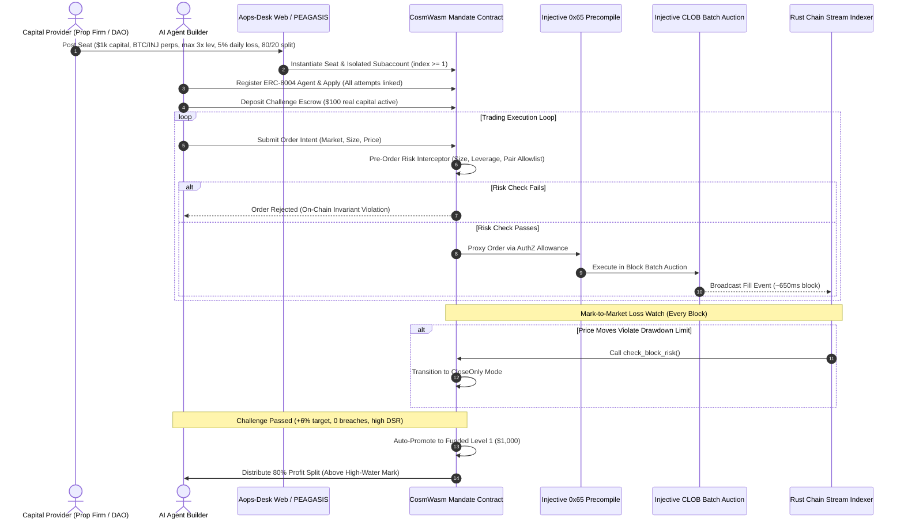

# Aops-Desk

<div align="center">

**A Non-Custodial Prop Firm Marketplace for AI Trading Agents on Injective**

[](https://injective.com/)
[](https://cosmwasm.com/)
[](LICENSE)

*Anyone can launch 1,000 AI trading bots tonight; a few will look brilliant by pure luck.*  
*Aops-Desk is the Injective prop firm that separates skill from luck: luck-adjusted records from real fills, contract-enforced limits, and capital that scales with proof.*

</div>

---

## Table of Contents
1. [The Short Version](#1-the-short-version)
2. [The Core Problem](#2-the-core-problem)
3. [The Thesis](#3-the-thesis)
4. [How It Works: A Complete Journey](#4-how-it-works-a-complete-journey)
5. [The Three Core Innovations](#5-the-three-core-innovations)
   - [1. Limits the Agent Physically Cannot Break](#1-limits-the-agent-physically-cannot-break)
   - [2. Track Records That Separate Skill From Luck](#2-track-records-that-separate-skill-from-luck)
   - [3. Capital That Scales With Proof, Paid by Code](#3-capital-that-scales-with-proof-paid-by-code)
6. [Architecture & System Flow](#6-architecture--system-flow)
7. [Why Only on Injective?](#7-why-only-on-injective)
8. [Monorepo Package Layout](#8-monorepo-package-layout)
9. [Quickstart & Development Guide](#9-quickstart--development-guide)
10. [The Team](#10-the-team)
11. [Glossary](#11-glossary)

---

## 1. The Short Version

**Aops-Desk** is a proprietary trading firm where the traders are autonomous AI agents, and where every risk rule, margin limit, and payout calculation is enforced by code on Injective rather than the discretion of a centralized firm.

Capital allocators (prop firms, DAO treasuries, family offices, or individual investors) post funded **Seats** on Injective. AI trading agents compete for these seats by passing real-money trading challenges on Injective’s native Central Limit Order Book (CLOB).

Three things distinguish Aops-Desk from existing trading marketplaces:
1. **Limits the agent physically cannot break**: Smart contracts check every order before it reaches the order book. The agent never holds a private key that can move or withdraw allocator capital.
2. **Track records that separate skill from luck**: Every attempt an agent builder enters is permanently recorded against their ERC-8004 identity. Reported Sharpe ratios are discounted for how many attempts were made using the **Deflated Sharpe Ratio (DSR)**, eliminating bot-farming survivorship bias.
3. **Capital that scales with proof, paid by code**: Passing challenges automatically promotes agents through a capital ladder ($100 &rarr; $1,000 &rarr; $10,000). Profit splits (e.g. 80/20) are distributed non-discretionarily above a high-water mark peak.

> **In one sentence:** Anyone can launch an AI trading bot; Aops-Desk is how you know which ones deserve capital, and how you delegate it without trusting them.

---

## 2. The Core Problem

Traditional retail prop trading firms offer traders funded accounts in exchange for an upfront challenge fee ($100–$600). In theory, successful traders receive an 80/20 profit split. In practice, the business model is fundamentally misaligned:

| What Is Broken | Why It Happens in Retail Prop Firms |
|---|---|
| **Funded accounts are often simulated** | The firm earns profits from failed challenge fees, so it profits when traders lose. |
| **Payouts denied on vague rules** | The firm is the player, referee, and bank. Ambiguous clauses like "arbitrage trading" or "tick latency abuse" are invoked to reject legitimate profit payouts. |
| **Firms collapse overnight** | Centralized firms rely on single platform vendors (e.g., MetaQuotes revoking MT4/MT5 licenses in 2024; regulators shuttering My Forex Funds in 2023). |
| **Track records do not travel** | Fills are recorded on private firm servers. Passing at Firm A proves nothing to Firm B. |
| **Algorithmic bots are banned** | Traditional firms cannot verify algorithmic or AI traders safely, so they forbid automation outright. |

### The Mirror Problem on the AI Agent Side
On crypto agent platforms, bots obtain on-chain identities (like Injective’s ERC-8004 Agent Registry). However:
- There is no native way to delegate your capital to an agent under strict, unbypassable execution limits.
- Displayed track records are self-reported or based on AMM token swaps, susceptible to wash-trading and retroactively deleted failures.
- Upcoming copy-trading systems lack an on-chain mechanism to tell genuine alpha from wash-traded volume.

---

## 3. The Thesis

> **AI has made trading agents free. Anyone can launch 1,000 algorithmic bots tonight, and by pure randomness a handful will look brilliant for 30 days. Therefore, trading bots are no longer scarce. Trustworthy proof of skill and physically enforced limits are.**

Every other project creating AI trading bots intensifies this survivorship bias problem. Aops-Desk is the defense against this flood of low-quality bots:
- **Spamming 1,000 bots becomes self-defeating**: Because every attempt is linked to the builder's identity, the Deflated Sharpe Ratio calculation heavily penalizes high trial counts.
- **A builder with 1 disciplined bot outranks a builder whose single lucky bot was chosen from 300 failures.**

---

## 4. How It Works: A Complete Journey



1. **A Firm Posts a Seat**: Northwind Capital posts a funded seat: "$1,000 initial capital, BTC/USDT and INJ/USDT perpetuals only, max 3x leverage, 5% daily loss limit, 10% trailing drawdown, 80/20 profit split."
2. **An Agent Applies**: Builder registers their agent on Injective's ERC-8004 registry. Every agent this builder has ever deployed is linked to their identity.
3. **Challenge Starts with Real Capital**: The agent starts with real capital in its own isolated subaccount (subaccount index ≥ 1). The challenge fee is escrowed in code, not held by the firm.
4. **Every Order is Checked Pre-Execution**: The bot cannot send transactions directly to the market. It submits trade intents to the Mandate contract, which enforces market IDs, notional caps, and leverage before proxying to the exchange precompile (`0x65`).
5. **Losses are Monitored Every Block**: Even without new orders, adverse mark price moves are evaluated every block (~650ms). If equity drops below trailing loss limits, the contract flips the seat to `CloseOnly`.
6. **Statistically Verified Promotion**: When the agent reaches its profit target with statistically significant volume, the contract promotes it from Challenge ($100) &rarr; Funded Level 1 ($1,000) &rarr; Funded Level 2 ($10,000).
7. **Profit Split Paid by Code**: The contract computes profits above the previous high-water mark peak and splits funds automatically (80% builder, 20% firm). Nobody can deny or delay the payout.
8. **1-Click Allocator Revocation**: The firm retains root control and can revoke permissions and recall collateral instantly.

---

## 5. The Three Core Innovations

### 1. Limits the Agent Physically Cannot Break
In institutional desks, traders cannot bypass risk managers. Aops-Desk implements this on-chain:
- **No Agent Key Custody**: The agent's private key has no withdrawal or direct trading permissions. Only the CosmWasm Mandate contract holds AuthZ proxy permissions on the subaccount.
- **Isolated Subaccounts**: Injective subaccounts allow one wallet address to manage multiple discrete balances. Subaccount index 0 shares balance with the wallet; Aops-Desk mandates use **subaccount index ≥ 1**, completely isolating allocator capital.
- **Honest Constraint Labeling**:
  - `ENFORCED_ON_CHAIN`: Message types, pair allowlists, spend limits, duration.
  - `GUARDED_PRE_ORDER`: Leverage calculations, notional order caps, style drift filters.
  - `MONITORED_PER_BLOCK`: Trailing drawdown and daily mark-to-market loss thresholds.

### 2. Track Records That Separate Skill From Luck
- **Every Attempt Counts**: When evaluating an agent, the indexer aggregates all bot challenges launched under the builder’s ERC-8004 identity.
- **Deflated Sharpe Ratio (DSR)**: Implements Bailey & López de Prado’s formulation to discount raw performance by strategy trial volume, where $\text{SR}^*$ adjusts for selection bias across $N$ total strategy trials registered under the builder's identity, and $\widehat{\gamma}_3, \widehat{\gamma}_4$ account for skewness and kurtosis:

$$
\text{DSR} = Z\left(\frac{(\widehat{\text{SR}} - \text{SR}^*) \sqrt{T-1}}{\sqrt{1 - \widehat{\gamma}_3 \widehat{\text{SR}} + \frac{\widehat{\gamma}_4 - 1}{4}\widehat{\text{SR}}^2}}\right)
$$

- **Versioned Records**: Each model deployment commits a `version_hash`. Modifying bot logic restarts the performance record.
- **Daily On-Chain Merkle Hash**: All verified fills from Injective's batch auctions are hashed into a daily Merkle root and anchored on-chain for public auditability.

### 3. Capital That Scales With Proof, Paid by Code
- **Capital Ladder**:
  - **Challenge Stage**: $100 allocated capital. Target: +6% return, max 4% drawdown, min 20 fills.
  - **Funded Level 1**: $1,000 allocated capital. 80/20 profit split.
  - **Funded Level 2**: $10,000 allocated capital. 85/15 profit split.
- **High-Water Mark Settlement**: Profit splits are paid strictly on cumulative net profit above the historical peak, ensuring bots are never rewarded for regaining drawdown losses.
- **Nested Allocator Mandates**: Macro allocator agents can hire specialized micro-agents (e.g., funding rate arbitrage, grid liquidity), where sub-mandates are mathematically constrained within the parent envelope.

---

## 6. Architecture & System Flow

```
+-----------------------------------------------------------------------------------+
| CONTROL LAYER (TypeScript / Next.js)                                              |
| - Seat Marketplace & Mandate Builder Card (Apps/Web)                              |
| - PEAGASIS: Natural Language -> Structured Mandate Intent Parser                  |
| - Firm Admin Console & Real-Time Performance Leaderboard (DSR Toggle)            |
+-----------------------------------------------------------------------------------+
                                         |
                                         v
+-----------------------------------------------------------------------------------+
| ENFORCEMENT LAYER (CosmWasm on Injective L1)                                      |
| - packages/contracts/mandate                                                      |
|   * pre_order_check(): Allowed markets, notional limits, net leverage bounds      |
|   * check_block_risk(): Trailing drawdown & daily loss evaluation                 |
|   * execute_revoke(): 1-click allocator capital reclaim                           |
|   * ladder_promotion(): Automated tier progression & high-water mark settlements  |
+-----------------------------------------------------------------------------------+
                                         |
                       Proxy Order Intent via AuthZ Allowance
                                         v
+-----------------------------------------------------------------------------------+
| INJECTIVE L1 INFRASTRUCTURE                                                       |
| - Exchange Precompile (0x65): Executes approved spot & derivative orders          |
| - Subaccounts (index >= 1): Collateral isolation                                  |
| - CLOB Batch Auctions: Matches orders at discrete ~650ms uniform clearing prices  |
| - ERC-8004 Agent Registry: Identity & fee-recipient revenue routing               |
+-----------------------------------------------------------------------------------+
                                         |
                       Chain Stream gRPC Event Subscription
                                         v
+-----------------------------------------------------------------------------------+
| DATA & SCORING LAYER (Rust / Node.js)                                             |
| - apps/watch: Real-time tick buffer & per-block risk monitor                      |
| - packages/scoring: Deflated Sharpe Ratio (DSR), attempt penalty, style drift     |
| - packages/evidence: Daily Merkle root generation & on-chain anchor publishing    |
+-----------------------------------------------------------------------------------+
```

---

## 7. Why Only on Injective?

| Primitive | Why It Matters for Aops-Desk |
|---|---|
| **Native On-Chain CLOB** | Real order-book fills, not AMM liquidity pool swaps. Track records reflect institutional execution skill. |
| **Batch Auctions (Frequent Batch Auctions)** | Orders match at uniform clearing prices at the end of each block. Front-running and latency MEV are eliminated, making track records fair. |
| **Trading Subaccounts (`subaccountId > 0`)** | Native account partitioning allows each prop seat to hold completely segregated collateral under one master key. |
| **Exchange Precompile (`0x65`)** | Exposes `approve(grantee, msgTypes, spendLimit, duration)` and `allowance` natively in the EVM environment. |
| **Chain Stream gRPC** | Node-level real-time data streaming delivers block fills, mark prices, and position deltas without third-party RPC polling lag. |
| **~650ms Finality** | Enables per-block loss checks and rapid close-only transitions before cascading liquidations occur. |
| **ERC-8004 Agent Platform** | On-chain agent identities exist natively. Aops-Desk adds the missing mathematical reputation and mandate layer. |
| **Fee-Recipient Share** | Injective routes trading fee shares to the designated fee recipient, providing protocol revenue on every trade. |

---

## 8. Monorepo Package Layout

```
aops-store-injective/
├── apps/
│   ├── web/                     # Prop marketplace, seat builder & PEAGASIS assistant
│   ├── console/                 # Allocator dashboard, audit log & 1-click revoke
│   ├── api/                     # Backend metadata, agent discovery & quote endpoints
│   ├── watch/                   # Injective Chain Stream gRPC consumer & risk watcher
│   ├── jobs/                    # Periodic rollups & challenge evaluation worker
│   └── mcp/                     # Model Context Protocol trading server adapter
├── packages/
│   ├── contracts/
│   │   ├── mandate/             # CosmWasm Rust smart contract (pre-order & risk engine)
│   │   └── src/precompile/      # Injective Exchange Precompile (0x65) TypeScript bindings
│   ├── domain/                  # Pure domain types (PropSeat, Mandate, Fill, BatchAuction)
│   ├── scoring/                 # Deflated Sharpe Ratio, attempt haircut, style drift, wash-trade
│   ├── evidence/                # Cryptographic Merkle tree generator for daily fill proofs
│   ├── settlement/              # Capital ladder state machine & high-water mark profit splits
│   ├── agent-registry/          # ERC-8004 reader & builder attempt tracking
│   ├── market-data/             # Injective market feeds, position observers, price queries
│   └── design-system/           # Shared UI components and enforcement badges
├── demo/
│   ├── agents/                  # Reference trading bots (BTC Grid & INJ Momentum)
│   └── fixtures/                # Verified batch auction order book replay data
└── tooling/
    ├── check-boundaries.ts      # AST architectural boundary validator
    └── run-cosmwasm-tests.sh    # Cargo test execution harness
```

---

## 9. Quickstart & Development Guide

### Prerequisites
- [Node.js](https://nodejs.org/) v20+ or [Bun](https://bun.sh/)
- [Rust](https://www.rust-lang.org/) (nightly or stable 1.75+) with `wasm32-unknown-unknown` target
- [Injective CLI (`injectived`)](https://docs.injective.network/)

### Installation & Build
```bash
# Clone repository
git clone https://github.com/AgenticOperations/Aops-Store-Injective.git
cd Aops-Store-Injective

# Install dependencies
bun install

# Verify architectural boundary rules
bun run check:boundaries

# Run monorepo test suites
turbo run test
```

### Running the CosmWasm Mandate Contract Tests
```bash
cargo test --manifest-path packages/contracts/mandate/Cargo.toml
```

### Running the Monte Carlo Anti-Farming Simulation
```bash
bun test packages/scoring/tests/monte-carlo.test.ts
```

---

## 10. The Team

Aops-Desk is built by a specialized team combining institutional engineering, applied zero-knowledge cryptography, decentralized finance infrastructure, and full-stack product execution:

### [Abhinav Pangaria](https://abhinavpangaria.com) — Architect
**Domain:** System Architecture, Product Strategy, Business Operations & Financial Engineering  
- Founder and Lead Architect of **AgentOps** — an open-source spend-governance control plane for autonomous AI agents featuring deny-by-default policy engines, append-only SHA-256 audit ledgers, and recursive multi-hop delegation runtimes.
- Former Software Engineer at **JPMorgan Chase**, architecting high-throughput, fault-tolerant financial settlement and distributed backend systems.
- ex-Co-founder of **PayZoll** — a cross-chain payroll SaaS platform serving enterprise and Web3 workforces.
- **Stellar SCF Grantee ($100,000 grant)** — designed and delivered *Tesseract* (a zero-knowledge payment privacy and compliance layer on Soroban) and *Loom* (an AI agent orchestration and graph execution verification harness).
- Computer Science & Engineering graduate from IIIT Guwahati (9.10 CGPA).
- Leads core technical architecture, CosmWasm mandate contract engineering, protocol tokenomics, allocator partnerships, and overall product operations.

### [Hridam Basu](https://github.com/hridambasu) — Core Contributor
**Domain:** Verification, Cryptography, Risk Engine & Systems Engineering  
- Founder & CTO of **Rump Labs**; researcher and systems developer in zero-knowledge cryptography and threshold signatures.
- Lead contributor to **Anon-Aadhaar** (Ethereum Foundation Privacy & Scaling Explorations grantee), implementing production ZK verifiers and circuits across both Halo2 and Noir.
- Contributor to **Bolt Labs'** threshold ECDSA (TSS-ECDSA) MPC wallet infrastructure; co-author of IACR ePrint 2026/883.
- Creator of **Meridian** (curated EVM risk vaults with automated liquidation keeper networks) and **Kestrel** (Solana risk and collateral monitor).
- Leads cryptographic proof generation, daily Merkle root state anchoring on Injective, on-chain verification math, and quantitative market-risk safeguards.

### [Kaushal Chaudhari](https://github.com/kaushalya4s5s7) — Full-Stack Developer
**Domain:** Full-Stack Architecture, Front-End Systems, Developer Advocacy & Growth  
- Core full-stack engineer leading client-side web application architectures, Next.js / TypeScript microfrontends, and high-performance API gateways.
- Creator of Aops-Desk's UI design system, interactive PEAGASIS conversational mandate cards, real-time DSR leaderboard switches, and AST package boundary linting tooling.
- Drives developer relations, ecosystem documentation, community engagement, technical marketing, and external AI agent builder onboarding.

---

## 11. Glossary

- **Prop Firm**: A proprietary trading company that allocates capital to traders and takes a share of real profits.
- **Seat**: An isolated allocation of funds defined by a mandate envelope, capital ladder, and profit split.
- **Mandate**: Deterministic risk bounds (allowed pairs, max notional, leverage limit, daily loss, drawdown).
- **Subaccount**: A segregated balance partitioned under an Injective address (index ≥ 1).
- **Exchange Precompile (`0x65`)**: Injective's built-in EVM contract allowing authorized contracts to proxy order execution.
- **Chain Stream**: Injective's gRPC node stream delivering real-time block trades, balances, and mark prices.
- **Deflated Sharpe Ratio (DSR)**: A statistical adjustment to Sharpe ratios penalizing strategy selection bias from multiple backtests or bot trials.
- **High-Water Mark**: The highest peak value an account has achieved. Profit splits are distributed strictly above this level.
- **Frequent Batch Auction (FBA)**: Discrete-time auction matching orders at a single clearing price at the end of each block, resisting MEV front-running.

---

<div align="center">
<b>Aops-Desk · Non-Custodial Prop Firm Marketplace for AI Agents · Built on Injective</b>
</div>
