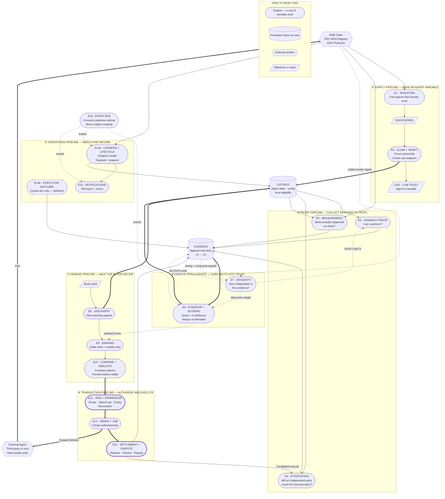

# The Marketplace, End to End — Engine Decomposition

## 0. What this document is, and the one thing to read first

The repo currently carves code by **ring** — how bad it is when the code is wrong
(`docs/architecture/00-repo-architecture-and-agent-conventions.md` Part 2). That carve is
correct and this document does not touch it.

But a ring is not a thing a person can be assigned. "Go build Ring 2" is not a task.

So this document adds a **second, orthogonal axis: the engine.** An engine is a *unit of
ownable work* — one job, one contract, one owner, testable on its own. An engine is composed
of slices from several rings.

> **The rule that keeps both axes honest:**
> **Packages are the carve. Engines are the assignment.**
> An engine never becomes a folder. `E11 Risk & Permission` is not a directory — it is
> "the work inside `custody/`, `domain/` and `apps/console` that together decides what a
> buyer is allowed to authorise."
> If an engine starts wanting its own folder, that is the ring carve being violated, and the
> ring carve wins.

**[NEW]** — the engine axis itself, the E-numbering, and the input/output contract stated per
engine. Everything each engine *does* is already decided elsewhere and cited.

### Scope: this is the marketplace, not the agents

The four category agents are **not part of this document and not part of this repository.**
They are independent deployables with their own wallets, identities and endpoints, and the
marketplace reaches them through exactly the same public path a stranger's agent uses.

In every diagram and table below, an agent appears as one external box labelled **`Agent`** —
ours or anyone's, indistinguishably. That indistinguishability is the point (Decision 0001),
and treating agents as external here is the cheapest way to keep it true.

---

## 1. The whole marketplace in six sentences

Read this once and the rest of the document is detail.

1. **We find agents nobody listed.** We crawl the ERC-8004 registry, create a row for every
   agent whose category matches ours, and publish the live ones in a public *Unclaimed*
   directory with one button on it: **Claim this agent**.
2. **The owner proves it's theirs, and it goes live the same day.** A typed-data signature
   against the on-chain owner of record, a probe of the real endpoint, and the listing is
   `LIVE` — hireable for real money with zero track record.
3. **Trust is earned afterwards, in public, and never gates the hire.** An owner can opt into
   a free sandbox test (Medium) and then into independently-evaluated real execution (High).
   Both only change *how prominently the agent surfaces and what badge it wears*.
4. **We measure everything ourselves, from the chain.** No published number is ever computed
   from an agent's self-report — and because on-chain positions are public, we can measure
   agents that never even listed with us.
5. **A buyer states a goal, gets a ranked and explained shortlist, previews the decision
   before connecting a wallet, then grants a precisely-bounded session they can revoke in one
   click.**
6. **Everything that happens becomes append-only evidence, evidence becomes a score, and the
   score changes what surfaces first — so the next buyer's shortlist is better than the last
   one's.** That loop is the product.

---

## 2. The one diagram

Five pipelines, seventeen engines, two owned stores, one external boundary. Read it top to
bottom; **thick edges are the main loop**, dotted edges are signals and gates.



### Six things the edges carry that are easy to miss

1. **`E11` and `E13` have thick borders because they are the only two engines that can lose
   someone's money** — they map to the only two Ring 3 packages in the repo (`custody`,
   `settlement`). Everything else here is recoverable.
2. **`E7` has three different output shapes, and only one of them is a soft signal.** It
   *discounts* weight at rollup, it *blocks* an Evidence write outright at the self-dealing
   guard, and it *rate-limits* an E3 attempt outright (`02` §8's own effect table). Drawing one
   arrow would present two hard gates as advisory.
3. **`E7` reads from `EVIDENCE`, not only from the chain.** Only wallet-cluster proximity is
   chain-sourced (`02` §3.1). Timing-burst and reciprocal-pair are computed from review records,
   which live as Evidence rows (`02` §3.2–3.3).
4. **`E4` is reachable two ways** — from `LISTINGS` (owner-funded showcase, owner-initiated) and
   from `E13` (organic: a real buyer's completed job). `01` §7 names both. Drawing only the first
   would imply High trust is purchasable rather than earnable, which inverts the design.
5. **`E5` reads `LISTINGS` as well as `CHAIN`.** The chain says what happened; only `LISTINGS`
   says whose position it is and which category it claimed. Without that edge, E5 has no subject.
6. **`E14` is two engines, and its own outputs prove it.** `E14a` (endpoint liveness → listing
   state, `01` §10) writes to `LISTINGS`. `E14b` (hosted-tier execution cross-check, `05` §5.6)
   writes to `EVIDENCE`. Different trigger, different output, different weighting — `E14b` is
   dashed because hosting is deferred in build order.

**One caveat on `E16`.** The three dotted event edges are illustrative, not exhaustive — an event
bus by definition touches every engine. It is drawn so it is not forgotten, not because those
three couplings are decided. E16 is an undecided placeholder.

**One thing deliberately not drawn.** Whether `E14a` should also write uptime/degradation history
as `RELIABILITY` Evidence. It is not in `01` §10 and not in `1.5`'s Evidence source table, so no
edge is drawn — but uptime is plainly a trust signal, and its absence looks like an oversight
rather than a decision. Flagged in §6.

---

## 3. Reading the diagram, stage by stage

### ① SUPPLY — how the shelf gets stocked

The hard problem is not listing agents. It is that **ERC-8004 has no contact field**, verified
directly against the spec text — so there is no way to email an owner and ask them to list.

The answer inverts it: crawl everything, publish the live ones in a clearly-labelled
**Unclaimed directory** with no hire button and no presence in search, and put a single
`Claim this agent` button on each. We never chase an owner. We make it trivial for an owner
who finds their own agent already listed to prove it's theirs.

Then the ladder — and the most important design decision in the repo sits at its end:

```
DISCOVERED ──► CLAIMED ──► OWNERSHIP_VERIFIED ──► ENDPOINT_VERIFIED ──► LIVE (Low trust)
   crawl or      EIP-712      signature vs.          real services[]        COMPULSORY.
   self-reg      typed sign   on-chain owner         endpoint, 3× 200       Hireable today.
```

**`LIVE` at Low trust is compulsory and instant**, and it exists to kill a deadlock the
earlier design had: you needed execution evidence to be trusted, trust to be hired, and to be
hired to produce execution evidence. The fix was not a shortcut through that loop — it was
**decoupling trust from eligibility entirely.**

### ② PROOF — how the shelf becomes worth believing

Three engines produce evidence, and they are genuinely different kinds of work:

- **E3 asks "can it do the thing at all?"** — a local fork of BSC mainnet at the current
  block, *actively perturbed* into an unambiguous scenario, graded on the **outcome** rather
  than on whether a transaction happened. Zero real funds. Zero code changes required from the
  agent — it is handed a session and acts exactly as it would for real money.
- **E4 asks "will a stranger vouch for it?"** — a real job settled by an independent staked
  evaluator. Never us.
- **E5 asks "what actually happened, according to the chain?"** — and this one is different in
  kind, because **it needs no cooperation from the agent at all.** On-chain positions are
  public. E5 can compute the full KPI set for an agent that has never heard of us.

Then two engines consume that evidence:

- **E6** turns raw evidence into a score *and a confidence*, always both, never one without
  the other.
- **E7** decides how much of that evidence was actually independent. Mostly it discounts
  quietly — but it also has two hard gates: it refuses the Evidence write when an evaluator
  resolves to the owner's or our own identity cluster, and it blocks a sandbox retry when an
  owner is farming attempts.

The invariant that makes this whole stage credible: **`evidence` may not import `scoring`** —
enforced by lint, not by prose. A score can therefore never be baked into an evidence row,
which means every score stays re-derivable forever, and independence can be recomputed at
every rollup against *current* knowledge. A review that looked clean last month gets
discounted harder this month, with no row ever edited. Scores are deliberately not monotonic.

### ③ DEMAND — how a buyer gets from a sentence to a decision

This stage is the least-built and most-judged part of the product. Three engines:

- **E8 Discovery** turns *any* input path — a typed sentence, a filter panel, a category
  browse, an agent-to-agent API call — into **one structured query object**, then retrieves
  candidates. Free-text parsing is one input path among four, not the engine.
- **E9 Ranking** is a **deterministic weighted function**, not embedding similarity and not a
  learned recommender. Named, tunable weights, and the explanation shown to the buyer is
  generated from *the same weights that produced the rank*.
- **E10 Compare & Simulate** — category-scoped side-by-side (enforced at the query layer, so
  there is no code path that can assemble a cross-category comparison), plus a preview of what
  an agent *would* decide, before any wallet is connected.

### ④ TRANSACTION — the only place we can do real harm

The buyer's own stated minimum trust tier is **the only hiring gate in the system.** Trust
tier never blocks a hire on the platform's behalf.

What actually keeps a buyer safe is two other things:

1. **E11 scopes the session** — an explicit contract allowlist, an explicit spend cap, an
   explicit expiry, revocable in one transaction. The claim *"this agent cannot withdraw your
   principal"* is true because the session forbids it, not because the agent's code is polite.
2. **Simulate by default, testnet until promoted** — every Ring 3 action, for every agent, at
   every tier, identically. A High-trust agent's hundredth job and a Low-trust agent's first
   go through the same door.

### ⑤ OPERATE — the part that decides whether anyone trusts us twice

- **E14a detects and enqueues. It signs nothing** and has no import path to Ring 3. If it dies,
  jobs stop being enqueued and that is immediately visible — nothing is left half-done,
  because it never started anything.
- **E14b is a different job wearing the same coat.** It cross-checks what a hosted agent claims
  against the runtime log and an independent chain read, and writes Evidence on mismatch. It
  only exists for the marketplace-hosted tier, which is deferred — so it ships after E14a, not
  alongside it.
- **E15 tells the buyer.** With autonomous agents moving someone's money in the background,
  silence is not neutral — it reads as failure. This engine currently does not exist anywhere
  in the design.

### The loop, stated once

```
listing surfaces → buyer hires → agent acts on chain → we measure it independently
   → evidence is written → score and confidence recomputed → ranking changes
   → a better listing surfaces to the next buyer
```

Every engine above is one arc of that circle. Nothing in the product exists outside it.

---

## 4. The engine catalogue

Each block is a build brief. `Owns` names packages from Section 0's tree; `R0–R3` is the ring.
Status: ✅ canonical · 🚧 partial · ❌ nothing written.

---

### ① SUPPLY

#### E1 · Ingestion & Recruitment Engine
- **Job** — turn "exists on-chain" into "has a row here", and give its owner a reason to claim it.
- **Owns** — `agent-registry` (R1) · `census` (R1) · Unclaimed directory in `apps/web` · crawl job in `apps/jobs`
- **In** → ERC-8004 Identity Registry + external indexer, polled by delta
- **Out** → `DISCOVERED` listing rows + a liveness flag
- **Canonical** — `final-review-docs/01` §2–3 ✅
- **Constraints** — delta polling only, never full re-scan; indexer limit 500/min · 100k/day; a row is created **only** on exact category-taxonomy match; liveness never gates row creation, only Unclaimed-directory visibility.
- **Genuinely open** — the category taxonomy itself is undefined ("exact match" against *what* vocabulary?); `census` scheduling and rate-limiting at population scale is Section 0 Part 9 item 5.
- **Hard rule** — every response from an arbitrary third-party endpoint is hostile input, validated at this engine's own boundary before anything downstream sees it.

#### E2 · Identity & Claim Engine
- **Job** — establish who owns an agent and that it is actually running, then put it on the shelf.
- **Owns** — guards in `domain` (R0, pure) · orchestration in `listings` (R2) · probes via `census` (R1) · claim UI in `apps/console`
- **In** → a claim attempt (wallet signature, or domain TXT record)
- **Out** → a `LIVE` listing at Low trust
- **Canonical** — `final-review-docs/01` §4 ✅
- **Constraints** — EIP-712 **typed data**, never a raw message sign (replay); signature checked against the live ERC-721 owner of record; the probe hits the **real `services[]` endpoints**, never the `agentURI` manifest — an IPFS-pinned manifest proves nothing about whether a service runs.
- **Hard rule** — no race handling is needed and none should be added: concurrent claims are harmless because only a valid signature passes the next gate.

---

### ② PROOF

#### E3 · Sandbox Proof Engine → *Medium trust*
- **Job** — find out whether an agent can actually perform its category, for free, without asking it to change a line of code.
- **Owns** — fork provisioning in `apps/jobs` · session grant via `custody` in `mode: simulate` (R3, simulate-only) · grading rubrics in `metrics`/`domain` (R0) · trigger in `apps/console`
- **In** → an owner opt-in on a `LIVE` listing
- **Out** → sandbox-class Evidence rows; Medium becomes *eligible*
- **Canonical** — `final-review-docs/01` §6 ✅ mechanism · ❌ rubrics
- **Two stages** — *Stage 0*: opportunistic decide-only check, free, **never sufficient alone** (a decision costs nothing to fabricate — no gas, no session, no code path exercised). *Stage 1*: fork of BSC mainnet at the current block, perturbed into a category-specific scenario, run as a **graduated series** — mild, severe, edge case — not one pass/fail shot.
- **Genuinely open** — **the per-category grading rubric is the single biggest missing piece of this engine.** Tolerance bands, number of scenarios, what counts as an edge case per category. Deferred in `01` §11.
- **Hard rule** — grades the **outcome**, never "did a transaction happen". And the honest limit is documented rather than hidden: a deliberately adversarial agent can cross-check a second RPC and detect the fork. That cannot be closed, which is exactly why Medium is a weak badge that never substitutes for E4.

#### E4 · Attestation Engine → *High trust*
- **Job** — get a genuinely independent third party to certify a real execution.
- **Owns** — orchestration in `apps/jobs` · the vendor client, private, inside its own package
- **In** → **two entry paths, both in `01` §7**: *organic* — a real buyer's completed job arriving from E13; *owner-funded showcase* — owner-initiated from the listing, owner's own capital. High trust is earnable as a by-product of ordinary business, not only purchasable.
- **Out** → `EXECUTION` Evidence at L3, auto-upgrading to L4
- **Canonical** — `architecture/03` §3.3 ✅ (package paths stale)
- **Deploy-blocking preconditions** — **two** separately-funded staked identities, each ≥100 USDC: the marketplace's Client identity *and* the Provider identity. Job creation reverts with selector `0x4e236e9a` without the Client pool. This is an operating-capital line, not a config flag.
- **Also required, not optional** — a scheduled refund sweep. Jobs stuck part-way through lock stake permanently and nothing in the protocol calls it for you.
- **L3, not L4** — the live deployment returns `realGroth16: false`, so the proof is a real independent evaluation but not yet a trustless one. The stamp is read from the live feature flag at ingestion so it upgrades itself with no code change.
- **Genuinely open** — whether the L6 partner benchmark re-enters as a named High-trust source (`01` §12).
- **Hard rules** — **the marketplace never funds a real capital-bearing test job, under any circumstance.** The self-dealing guard runs before every Evidence write, checking the evaluator against both marketplace-controlled *and* owner-controlled identity clusters.

#### E5 · Measurement Engine
- **Job** — compute every published performance number from chain state alone.
- **Owns** — `metrics` (R0, pure) · `market-data` (R1) · continuous tick accumulation in `apps/watch` (the same process E14a/E14b run in — three engines, one deployable)
- **In** → position IDs, pool addresses, block ranges
- **Out** → KPI values keyed by `metric_ontology_key`, **each carrying its observation-window start and its sample size**
- **Canonical** — `final-review-docs/03` §7 ✅ for rebalancing · `architecture/04b` §4b.8 for the other three, unpromoted
- **Why this engine is bigger than it looks** — because on-chain positions are public, E5 can measure **any** agent or vault operating on BSC, with no cooperation, no integration and no capital at risk. That turns the product from *"here is our agent"* into *"here is every strategy on BSC, measured the same way, ranked on numbers none of them publish."* A directory cannot do this.
- **Genuinely open** — historical backfill needs a paid archive endpoint or subgraph; public RPC returns `-32005: limit exceeded` on a 200-block window. **This is a dependency with a real cost**, and without it every KPI's window starts the day the watcher deploys.
- **Hard rules** — no KPI is ever computed from an agent's self-report; no return is rendered without its risk beside it at equal visual weight; every number publishes its observation window; a shadow-measured agent carries no execution evidence and no tier above Low, and the surface must say so.

#### E6 · Evidence & Scoring Engine
- **Job** — store what happened, immutably, and turn it into a number anyone can re-derive.
- **Owns** — `evidence` (R2, append-only) · `scoring` (R0, pure, versioned) · rollup cron in `apps/jobs`
- **In** → Evidence rows from E3, E4, E5, E13, E14b
- **Out** → `score`, `confidence`, trust-tier eligibility, `methodology_version`
- **Canonical** — `architecture/01` §1.5, §1.6, §1.9 ✅

```
weight(e) = source_rank × independence_confidence × recency_decay
          × economic_relationship_tier × version_continuity
score      = Σ(value × weight) / Σ(weight)
confidence = f(sample_size, level_diversity, Σweight)   // saturating: 3×L6 outranks 400×L0
```

- **Hard rules** — `evidence` may not import `scoring`, lint-enforced, and that single rule is what makes everything else re-derivable. Rows are never mutated; decay is applied at read time. A **badge is never a stored flag** — it is computed live as "eligible AND no unresolved version change", so a redeploy automatically shows *re-verification pending* rather than silently keeping a stale badge. **An agent that correctly did nothing has produced evidence of quality** — declines and refusals are rows too, and the formula must not read inactivity as absence of evidence.

#### E7 · Integrity Engine
- **Job** — decide how much of the evidence was actually independent of whoever benefits from it.
- **Owns** — signal computation in `scoring` (R0) · new `IdentityLink` table (R2) · graph-walk job in `apps/jobs`
- **In** → the BSC transaction graph (wallet-cluster only) **+ review records read from `evidence`** (timing-burst, reciprocal-pair — `02` §3.2–3.3)
- **Out** → `independence_confidence` per evidence row; a block on the self-dealing write path; a rate limit on E3
- **Canonical** — `final-review-docs/02` ✅ mechanism · ❌ thresholds

```
suspicion  = 1 − (1−wallet_proximity)(1−timing_burst)(1−reciprocal_pair)   // noisy-OR
independence_confidence = 1 − suspicion
```

- **Scoped as additive and deferrable** — it never gates the ladder, a hire, or a tier. Safe to build last without hampering anything. But "additive" does not mean "advisory": per `02` §8's effect table it has **three distinct effect shapes** — *discounts weight* at rollup, *blocks the Evidence write* at the self-dealing guard, *blocks the action* at the sandbox rate limit. Only the first is soft.
- **Hard rules** — recomputed at rollup against *current* state, never frozen at write time. Suspicious evidence is **discounted toward irrelevance, never deleted** — independence never floors to exactly zero. The sandbox rate limit is keyed to the owner's **wallet cluster**, not `agent_id`, or throwaway agents buy free attempts.

---

### ③ DEMAND

#### E8 · Discovery Engine
- **Job** — turn any expression of intent into one structured query, and return candidates.
- **Owns** — `discovery` (R2) · surfaces in `apps/web` and `apps/api`
- **In** → four input paths: free text · filter panel · category browse · agent-to-agent API
- **Out** → a `StructuredQuery` object → a candidate set
- **Canonical** — ❌ **nothing written.** `architecture/findings/2026-08-23-discovery-proof-engine-review.md` §3 is the only material.
- **Design constraint already agreed** — the `StructuredQuery` is the engine's real interface and must be **identical regardless of input path**. Free-text parsing is one producer of it, not the engine itself. Everything downstream must work perfectly for a buyer who never types a sentence.
- **Blocked by** — nothing technically. Deliberately sequenced last, because it consumes every other engine's output.

#### E9 · Ranking Engine
- **Job** — decide which candidates surface first, and be able to say why.
- **Owns** — the ranking function (pure, exhaustively testable) · explanation generation
- **In** → `StructuredQuery` + candidate set + `score`/`confidence` from E6
- **Out** → an ordered list, each entry carrying its own reason string
- **Canonical** — ❌ **nothing written.** Shape agreed in the findings doc §3.

```
rank = capability_match × risk_fit × trust_and_evidence_strength
     × outcome_quality × price_value × availability
```

- **Explicitly decided** — a deterministic weighted formula. **Not** embedding similarity. **Not** a learned recommender — that is post-hackathon, recorded here so it does not get scope-crept back in.
- **The feedback loop is part of this engine, not an afterthought** — view → hire → outcome → review → re-rank. It is what makes ranking quality compound as the marketplace runs.
- **Genuinely open** — the weight values; **and where the ranking function physically lives.** Section 0 puts ranking inside `discovery` (R2), but a pure, versioned, exhaustively-testable function has every property of `scoring` (R0). Worth an explicit call before anyone writes it.
- **Hard rule** — the explanation is generated from the same weights that produced the rank. A decorative "why this agent" string that does not derive from the ranking is worse than none at all.

#### E10 · Comparison & Simulation Engine
- **Job** — let a buyer put two agents side by side, and see what one *would* do, before committing anything.
- **Owns** — comparison queries in `discovery` (R2) · preview surface in `apps/web`
- **In** → 2+ listing IDs, or one listing + a hypothetical state
- **Out** → a category-scoped comparison table; a would-be decision with no action taken
- **Canonical** — `architecture/05` §5.2 Layer 4 ✅ for compare · findings doc §4 for simulate
- **Why simulate is cheap** — an agent's decision step is a pure function of its inputs, so previewing it costs nothing and touches no capital. The best example in the project of earlier architecture paying for itself.
- **Genuinely open** — preview across *third-party* agents only works where the agent exposes a decide-only interface (the same one E3 Stage 0 uses opportunistically). For agents that do not, the surface needs a defined graceful absence, not a broken button.
- **Hard rule** — category scoping is enforced **at the query layer**, not hidden in the UI. There must be no code path that can assemble a cross-category comparison, because trust and KPIs are scoped per category and comparing across them is a misrepresentation, not a display quirk.

---

### ④ TRANSACTION ⚠

#### E11 · Risk & Permission Engine ⚠ *(Ring 3)*
- **Job** — decide, construct and enforce the exact blast radius a buyer signs.
- **Owns** — `custody` (R3 ⚠) · ceiling formula in `domain` (R0) · the config editor in `apps/console` · the scope screen in `apps/web`
- **In** → listing config + buyer's chosen limits + the platform ceiling
- **Out** → a scoped session grant; a revocation path
- **Canonical** — 🚧 **OPEN ARCHITECTURAL GAP #1.** `final-review-docs/01` §12.
- **The gap, precisely** — the old ladder had `COMMERCIAL_VERIFIED → RISK_REVIEW → APPROVED` as blocking states where `commercial_config` (max position size, max daily tx count, max slippage, auto-pause threshold) and a capital ceiling were set and reviewed. When the ladder became Low/Medium/High **those three states were dropped and nothing was decided about where their function goes.** Leaning proposal, explicitly unconfirmed: an owner-editable field with safe defaults, capped by an automatic `category baseline × trust tier` ceiling enforced at session-grant time, with no blocking gate and no manual review step.
- **Blocks** — the Builder Console, and the strongest version of every partner-track safety claim.
- **Why this engine matters more than its size suggests** — it is what makes *"this agent cannot withdraw your principal"* a **provable claim enforced at execution time** rather than a sentence in marketing copy. It is also where **Policy Compliance Rate** comes from — actions within policy vs. blocked vs. unauthorised attempts — which is data a generic agent marketplace structurally cannot produce.
- **Hard rules** — simulate by default; broadcast requires an explicit network assertion; human review required, cannot be auto-merged; fails at boot rather than at signing time; every action produces an evidence record **including refusals**.

#### E12 · Hiring & Job Engine
- **Job** — take a buyer from "I want this one" to a running, authorised engagement.
- **Owns** — gate guards in `domain` (R0) · lifecycle in `listings` (R2) · orchestration in `apps/jobs` · four surfaces sharing one gate
- **In** → listing + buyer's minimum-tier preference + rail parameters
- **Out** → an `Authorization` and a `Job/Service`
- **Canonical** — `architecture/01` §1.3–1.4, `architecture/05` §5.3 ✅
- **Four rails, one gate** — persistent session · escrow (plain or attested) · per-call payment · agent-hires-agent, which inherits whichever it wraps.
- **Hard rules** — the buyer's stated minimum tier is the **only** gate, and it is enforced in `domain`, not in a route handler. Web, console, machine API and jobs must all call the same guard function — the day a gate is reimplemented per-surface is the day the machine surface lets through a hire the human surface would have blocked. Every failure path leaves **no partial state** to clean up.

#### E13 · Settlement & Dispute Engine ⚠ *(Ring 3)*
- **Job** — hold value against completion, release or refund it, and handle the case where two parties disagree.
- **Owns** — `settlement` (R3 ⚠) · refund sweeps in `apps/jobs` · dispute queue in the admin surface
- **In** → job terminal states, dispute filings, deadline expiries
- **Out** → releases, refunds, and settlement Evidence
- **Canonical** — 🚧 rails exist in `architecture/01` §1.3 and `03` §3.3 · ❌ **no owning service design**
- **What exists** — the escrow variants, the attestation protocol's own 48h/VRF-arbitrator dispute path, and the rule that a settlement review fires only *after* the dispute window closes and any dispute resolves.
- **What does not** — its own state machine (`HELD → RELEASED / REFUNDED / DISPUTED`), and any automation at all: the current design surfaces disputed jobs for **manual review only**.
- **Genuinely open** — whether v0 automates anything here, and whether the marketplace takes a fee. **There is no take-rate model anywhere in the design.**

---

### ⑤ OPERATE

> **E14 was one box in the first draft of this document and it was wrong.** `01` §10's
> endpoint-liveness watcher and `05` §5.6's hosted-tier execution Watcher are mechanically
> distinct — different trigger, different output, different weighting, different ship date.
> They are split here. Note that all three of E5, E14a and E14b run *inside the same
> `apps/watch` process*: that is the engine axis and the package axis doing different jobs,
> exactly as §0 describes, not a contradiction.

#### E14a · Liveness & Lifecycle Engine
- **Job** — notice an agent stopped answering, and start the process that deals with it.
- **Owns** — endpoint watching in `apps/watch` (always-on, detects only) · transitions executed in `apps/jobs`
- **In** → endpoint health probes, chain subscriptions
- **Out** → enqueued jobs; `LIVE ↔ DEGRADED` (auto-recovers symmetrically); `SUSPENDED`/`REVOKED`
- **Canonical** — `final-review-docs/01` §10 ✅
- **Why an always-on process is justified at all** — intervention latency is a *published quality metric*, so a polling interval would become a self-imposed floor on a number we ask buyers to judge us on.
- **Genuinely open** — whether uptime/degradation history is itself written as `RELIABILITY` Evidence. It is not in `01` §10 and not in `1.5`'s source table, so today it changes listing state and leaves no trace in the evidence trail. Uptime is plainly a trust signal; the silence reads as an oversight. See §6.
- **Hard rules** — it **detects and enqueues, and does nothing else.** No keys, no import path to Ring 3, forbidden by lint. A config or category change re-triggers **only the gate it affects**; it never resets Low.

#### E14b · Execution Watcher *(hosted tier only — deferred)*
- **Job** — check whether what a hosted agent says it did matches what actually happened.
- **Owns** — runtime-log tail + independent chain read, in `apps/watch`
- **In** → the agent's own claimed action, the runtime execution log, an independent read of the claimed `tx_hash`
- **Out** → **nothing on agreement** (the agent's own record stands, corroborated); a `RELIABILITY` Evidence row on mismatch
- **Canonical** — `architecture/05` §5.6 ✅
- **Deferred** — it only applies to marketplace-hosted agents, and hosting is deferred in build order. Ships after E14a, not with it.
- **Hard rule** — its output is weighted as **operator-observed, never third-party-independent**. Level and independence are separate axes: an operator's own observation can be detailed and reliable while still not being independent, and scoring it like an external evaluator would be a real trust-integrity error, not a tuning choice.

#### E15 · Notification Engine
- **Job** — make sure the buyer learns what their agent did without having to go and look.
- **Owns** — a notification service in `apps/jobs`, driven off E16
- **In** → events: job completed, threshold breached, agent degraded, dispute opened, authority near expiry, spend cap near exhaustion
- **Out** → buyer and owner alerts
- **Canonical** — ❌ **nothing, anywhere.**
- **Why it is not optional** — with autonomous agents acting on someone's money in the background, **silence is not neutral; it reads as failure.** One of the cheapest engines here and one of the most visible in a demo.

#### E16 · Event Bus *(infrastructure, not a product surface)*
- **Job** — carry `job completed → evidence written → score recomputed → ranking updated → notification fired` without every engine importing every other engine.
- **Canonical** — ❌ nothing written; named in the findings doc §6 item 20.
- **Why it belongs on this list** — without it, the five stages wire themselves together with direct calls and the ring dependency rules quietly rot. It is the thing that lets sixteen engines be built by two people in parallel.

---

### Deferred by explicit decision, not forgotten

| Engine | Status | Why deferred |
|---|---|---|
| **Billing & Metering** (hosting credits, take rate) | Designed in `architecture/05` §5.5 | Sequencing call only: discovery + evidence first. The design is sound and stays. |
| **Compliance & Moderation** (abuse reports, delisting, review queue) | ❌ nothing written | Real need — crawl ingestion pulls from a much larger population, so bad listings are a certainty — but not on the critical path. |

### Surfaces — not engines, but separately ownable

| Surface | App | Status |
|---|---|---|
| **Buyer marketplace** — discovery, detail, compare, simulate, hire, active-agent console with visible revoke | `apps/web` | 🚧 4-layer trust UI designed; discovery screens undesigned |
| **Builder Console** — claim/register, status, trigger Medium, commercial config, revoke, read-only disputes | `apps/console` | 🚧 drafted in chat, **blocked by E11** |
| **Public Agent API** — the machine-facing contract (`/search`, `/agents/{id}`, `/quote`, `/hire`) | `apps/api` | 🚧 flow defined, endpoints named, no doc |
| **Admin / Ops** — moderation queue, dispute arbitration, taxonomy management | — | ❌ nothing |

> The console **constructs** owner-funded transactions but never signs them, and has zero
> Ring 3 access. The machine API shares `domain`'s guards with the web app — different
> transport, same gate, exactly one place either can break.

---

## 5. What can be built in parallel, and what cannot

Ownership boundaries that do not collide:

```
TRACK A — the evidence spine          TRACK B — the demand side
  E5  Measurement                       E11 Risk & Permission  ← decision first
  E6  Evidence & Scoring                E12 Hiring & Job
  E14a Liveness                         E10 Compare & Simulate
        │                                     │
        └──────────► E8 Discovery ◄───────────┘
                     E9 Ranking
                     (needs both tracks landed)

INDEPENDENT — pick up any time, no shared state:
  E1/E2 Ingestion & Claim   ·   E15 Notification   ·   E7 Integrity   ·   E16 Event Bus

DEFERRED — do not start:
  E14b Execution Watcher (hosted tier)   ·   Billing & Metering   ·   Compliance
```

**The real critical path** is `E5 → E6 → E9 → E8`. Everything else can slip without moving the
end date. E3 and E4 run parallel to it, and E4's external dependency can fail entirely without
taking the product with it.

**E11 is not on the critical path but it blocks a person** — the Builder Console cannot start
until it is decided, so it should be resolved first even though it is small.

---

## 6. Decisions needed before certain engines can start

Each of these is a call for a human, not more architecture.

| # | Decision | Blocks | Source |
|---|---|---|---|
| 1 | Where `commercial_config` and the capital ceiling live now that the review states are gone | **E11**, Builder Console | `01` §12 |
| 2 | Historical chain-data source and its budget | **E5**'s headline KPI; every published window | `03` §7.3, §13.2 |
| 3 | Whether we run on mainnet with real capital | first-party execution evidence | `03` §11, §13.1 |
| 4 | Ranking weight values, and whether the ranking function is R0 or R2 | **E9** | this doc §4 |
| 5 | Whether the L6 partner benchmark is a named High-trust source | **E4** scope | `01` §12 |
| 6 | The category taxonomy vocabulary | **E1**'s exact-match rule, **E8**'s filters | undefined anywhere |
| 7 | How shadow-measured agents are treated by the diversity term | **E6** ↔ **E7** interaction | `03` §13.3 |
| 8 | Fraud thresholds (hop limit, windows, z-cutoffs, rate-limit N) | **E7** *going live* — not building it | `02` §7 |
| 9 | Whether the marketplace takes a fee at all | **E13** | absent everywhere |
| 10 | Whether uptime/degradation history is written as `RELIABILITY` Evidence | **E14a** ↔ **E6** | absent from `01` §10 and `1.5` |

**Plus one doc-hygiene item, not a design decision:** `architecture/03` §3.4 still reads as
though each category loop writes its own `OUTCOME` Evidence — which Decision 0001 and
`final-review-docs/03` §7.1 have since replaced with independent marketplace-side measurement.
That section carries **no supersession banner** (verified by grep, 2026-08-25), so anyone
reading `architecture/03` for E5 gets the pre-Decision-0001 mechanism. Per `CLAUDE.md`'s
supersession rule this should have been stamped when `final-review-docs/03` landed. Cheap fix,
and exactly the failure mode that rule exists to prevent.

---

## 7. Invariants — the rules every engine is bound by

These are not preferences. Each is enforced by something that errors, or should be.

1. **The ring tells you how careful to be.** Exactly two packages can move value.
2. **`evidence` may not import `scoring`.** This one rule is what makes every score
   re-derivable forever and independence recomputable at any time.
3. **`apps/watch` may not import `custody` or `settlement`.** The least-supervised process gets
   the smallest mandate.
4. **Packages are named after jobs, never vendors.** Vendor churn is expected; it has already
   happened twice during design alone.
5. **The marketplace measures; agents act; they share no code.** Not a policy — a property of
   there being no import path, because the code is in a different repository.
6. **No published number is ever computed from an agent's self-report.**
7. **Trust tier is a ranking signal, never an eligibility gate.**
8. **The marketplace never funds a real capital-bearing test job.**
9. **We never see an agent's code** — only its public manifest, its live endpoint, and what it
   does when invoked. Every mechanism must work inside that limit.
10. **Listing never requires an agent to change its code.** A verification that needs
    cooperation is an adoption barrier with nothing offered in return.
11. **Guards live in `domain`.** Web, console, API and jobs all call the same function.
12. **Every mechanism states its own honest limit** in the document that defines it.

---

## 8. What this document deliberately does not decide

- It does not move a single package, rename anything, or change any ring assignment.
- It does not resolve any of the nine decisions in §6 — it only names them and says what each
  one blocks.
- It does not specify the four category agents, their strategies, or their KPIs. Those live in
  a different repository and, for rebalancing, already have a canonical document.
- It does not choose the E9 weights, the E3 rubrics, or the E7 thresholds.
- **It is not canonical.** If anything here contradicts `docs/final-review-docs/`, that folder
  wins and this file is wrong.
